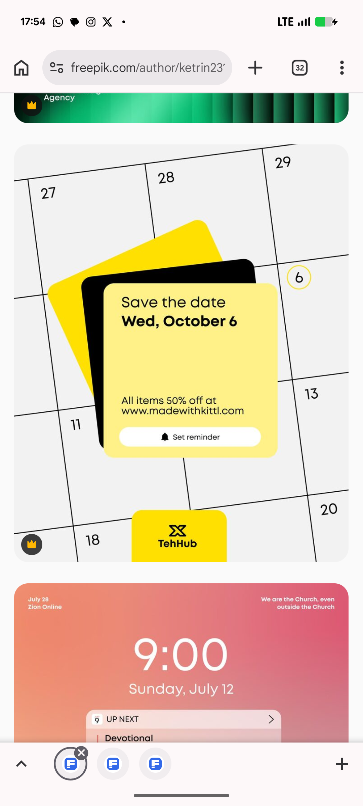

# Save the Date Cards over a Tilted Calendar

**Discipline:** print-social · **Design type:** Social promo post
**Tags:** save-the-date, calendar, yellow, black, tilted-cards, reminder, vector

## What it is
A light-grey square post with a tilted calendar grid of large black numerals, a stack of a yellow, a black and a pale yellow card reading 'Save the date Wed, October 6', a discount line with a URL, a white Set reminder pill with a bell icon, a circled date and a yellow logo tab at the base; below it a coral-to-teal lock-screen graphic.

## What it means
Layered cards on a calendar make the date feel pinned, and yellow with black is instantly attention-grabbing.

## Techniques
- Tilted calendar grid as the background
- Stacked cards in yellow and black
- Circled date as a hand-drawn cue
- White pill button with an icon
- Logo tab peeking from the bottom edge

## Best for
- Sale and event date announcements
- Calendar-themed posts
- Yellow and black promo systems

## Vocabulary
- **Save the date** — A notice announcing a date in advance.
- **Calendar backdrop** — A calendar grid used as a background pattern.
- **Reminder pill** — A button for setting a reminder.
