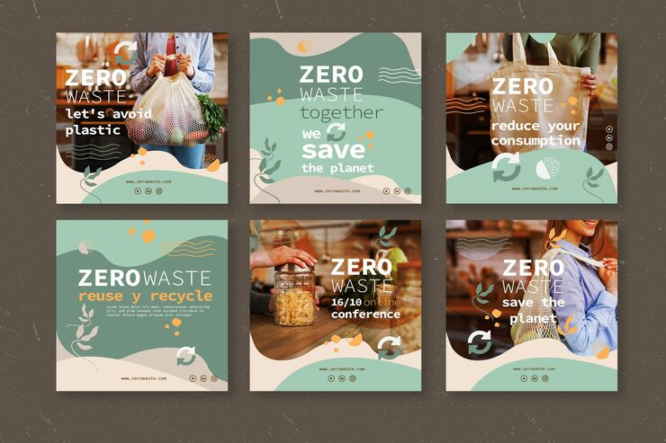

# Zero Waste pack in sage and cream with organic shapes, leaf line art and monospaced type

**Discipline:** print-social · **Design type:** Social template pack · **Design style:** Warm & Organic
**Tags:** zero-waste, eco, sage, cream, organic, monospace

## What it is
Six posts with photos of mesh produce bags, tote bags and jars, overlaid by sage and cream organic blob shapes, leaf line drawings, orange dots, wavy lines and recycle icons, with 'ZERO WASTE' in bold and slogans in a monospaced type ('let's avoid plastic', 'reuse y recycle').

## What it means
Calm and eco-friendly; organic shapes and typewriter type feel natural and honest.

## Techniques
- Blend photos into organic colour shapes.
- Use a monospaced font for a handmade, typewritten voice.
- Add leaf line art and recycle icons.
- Keep a muted sage palette.

## Best for
- Eco brands
- Sustainability campaigns
- Refill shops

## Vocabulary
- **Monospaced type** — A font where every character has equal width.
- **Organic shape** — A free-flowing irregular form.
