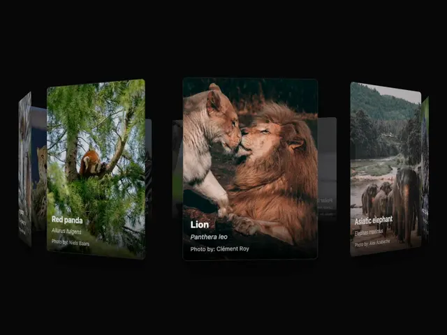

# Row of animal photo cards (red panda, lion, elephant) tilted in 3D on black, the centre card facing forward with caption

**Discipline:** web · **Design type:** UI components
**Tags:** component, carousel, 3d, photo-cards, dark, captions, perspective, gallery

## What it is
A black background with tall rounded photo cards on a horizontal path that rotate in 3D: the centre card of two lions faces the viewer with a white title 'Lion', an italic Latin name and a photographer credit, while neighbouring cards of a red panda and elephants angle away and narrow.

## What it means
Immersive and tactile; tilting cards turn a gallery into a rotating exhibit.

## Techniques
- Rotate side cards in perspective.
- Show captions on the focus card.
- Fade edge cards.
- Use a black stage.

## Best for
- Photo and nature galleries
- 3D carousel components
- Dark showcase sections

## Vocabulary
- **Cover-flow carousel** — A carousel where side items are angled away.
- **Focus card** — The forward-facing central card.
- **Caption overlay** — Text laid over the bottom of a photo.
- **Photo credit** — A line naming the photographer.
