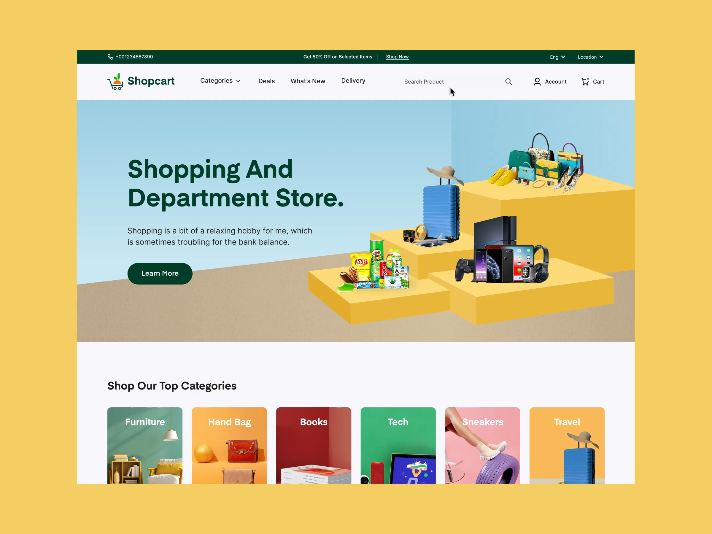

# Podium Product Display Store Homepage

**Discipline:** web · **Design type:** E-commerce
**Tags:** ecommerce, podium, yellow, green, 3d, department-store, categories

## What it is
A store homepage on a mustard backdrop with a dark green top bar, a light blue hero where products (bags, luggage, electronics, snacks) sit on stacked yellow podiums, a bold green headline and a row of colorful category tiles below.

## What it means
Staged products on podiums feel like a showroom, and the blue, yellow and green palette is cheerful and approachable for a broad shopping audience.

## Techniques
- Cut-out products arranged on stepped platforms as a hero illustration
- Deep green type and buttons as the anchor against pastel color
- Category tiles each with its own saturated background color
- Utility bar for promo and language above the nav
- Simple flat sky and ground planes behind the podiums

## Best for
- Multi-category retail sites
- Marketplaces
- Campaign landing pages with many product types

## Vocabulary
- **Podium staging** — Products arranged on stepped blocks as if in a display.
- **Category tile** — A colorful card that links to a product category.
- **Utility bar** — A thin strip above the nav for promos and settings.
