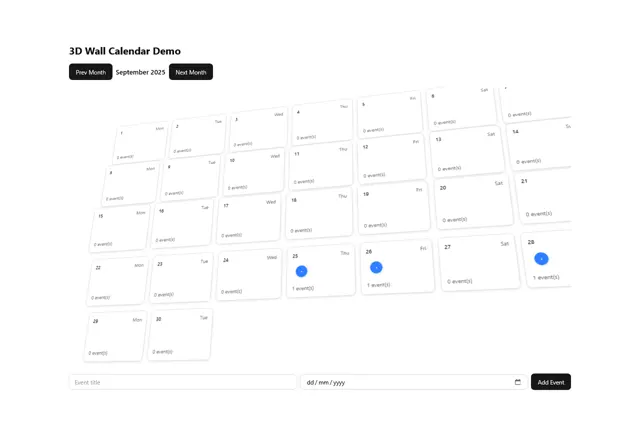

# Month calendar drawn as tilted paper tiles in perspective with blue event dots and an add-event form

**Discipline:** web · **Design type:** UI components
**Tags:** component, calendar, 3d, perspective, white, blue, tiles, form

## What it is
A white page titled '3D Wall Calendar Demo' with black Prev and Next Month buttons around 'September 2025', and a grid of white date tiles rotated in 3D perspective like a wall, each showing the day, weekday and '0 event(s)', with a few blue circular markers, and a bottom row with an event title input, a date input and a black Add Event button.

## What it means
Playful and spatial; perspective turns a flat month into a wall you look across.

## Techniques
- Rotate a grid of tiles in perspective.
- Add shadows to each tile.
- Use blue dots for events.
- Keep the controls flat.

## Best for
- Calendar components
- 3D transform experiments
- Event planning UIs

## Vocabulary
- **Perspective grid** — A grid transformed to recede in 3D.
- **Date tile** — A card representing one day.
- **Event marker** — A dot showing an event on a date.
- **Month controls** — Buttons for moving between months.
