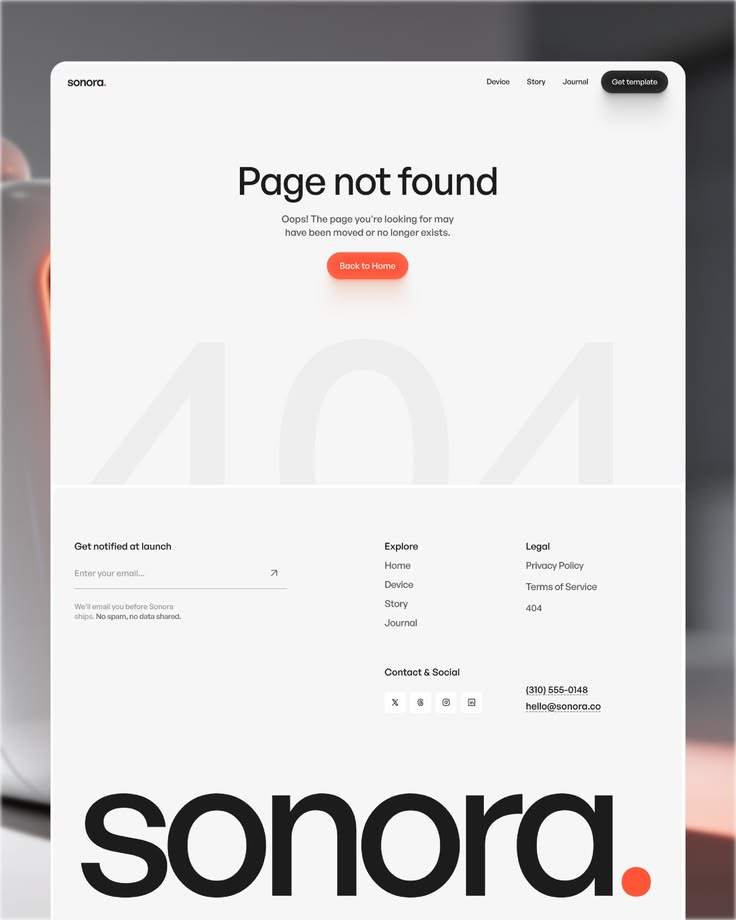

# Page-not-found screen with ghost 404, coral button and enormous cropped wordmark

**Discipline:** web · **Design type:** Page section
**Tags:** 404, error-page, light-grey, coral, ghost-numerals, footer, giant-wordmark, blurred-photo

## What it is
A white card on a blurred photo backdrop. A small nav sits at the top, a centred 'Page not found' headline with a short line and coral pill button, huge faint '404' numerals cropped behind, a footer with email signup and link columns, and a giant black 'sonora.' wordmark with a coral dot.

## What it means
Friendly and polished; even an error page feels on-brand.

## Techniques
- Set faint giant numerals behind an error message.
- Use one coral accent for the button and the wordmark dot.
- Combine an email capture with the footer links.
- End with a huge lowercase wordmark cropped at the bottom.

## Best for
- Error and utility pages
- Product landing footers
- Minimal hardware and consumer brands

## Vocabulary
- **Ghost numerals** — Huge low-contrast digits behind content.
- **Accent dot** — A single coloured full stop in a wordmark.
- **Footer wordmark** — An oversized brand name closing the page.
- **Error state** — A screen shown when something is missing or fails.
