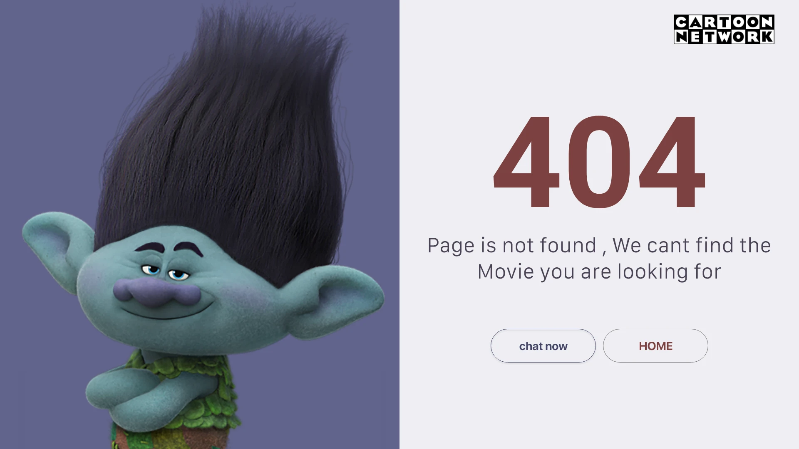

# 404 page: cartoon character on periwinkle beside giant maroon numerals and two outlined buttons

**Discipline:** web · **Design type:** Page section
**Tags:** 404, error-page, split-layout, character, periwinkle, maroon, outlined-buttons, entertainment

## What it is
A split screen: left a periwinkle field with a smug blue-green troll character with black upright hair; right a pale panel with huge bold maroon '404', a short line of text and two outlined pill buttons 'chat now' and 'HOME', with a network logo at the top right.

## What it means
Humorous and on-brand; a character with attitude softens a dead end.

## Techniques
- Use a brand character as the error mascot.
- Split the screen into image and message.
- Set giant bold numerals in one maroon.
- Offer two outlined pill exits.

## Best for
- Entertainment and kids' brands
- Error and empty states
- Character-led pages

## Vocabulary
- **Error mascot** — A character used on an error page.
- **Split screen** — A page divided into two halves.
- **Outlined pill** — A capsule button with a border only.
- **Dead-end exits** — Buttons offering ways out of an error.
