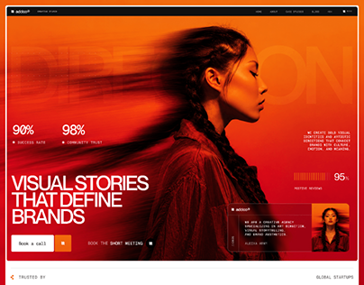

# Addoor creative agency hero: red-orange motion-blurred portrait with stats and condensed caps

**Discipline:** web · **Design type:** Agency site · **Design style:** Photographic & Cinematic
**Tags:** agency, red, motion-blur, portrait, stats, hero

## What it is
A red-orange hero with a woman in profile whose hair smears with motion blur, a ghosted 'DIRECTION' word behind, '90% Success Rate' and '98% Community Trust' stats, white condensed 'Visual stories that define brands', a 'Book a call' button, a 95% review badge and a small card with a founder photo.

## What it means
Bold and cinematic; one hot colour and motion blur feel fast and fearless.

## Techniques
- Blur part of a portrait to create motion.
- Bathe everything in one saturated hue.
- Scatter small stats and labels like HUD data.

## Best for
- Creative agency sites
- Studio portfolios
- Brand-led heroes

## Vocabulary
- **Monochrome wash** — An image tinted almost entirely in one colour.
- **HUD** — Heads-up display: small data overlays around a view.
