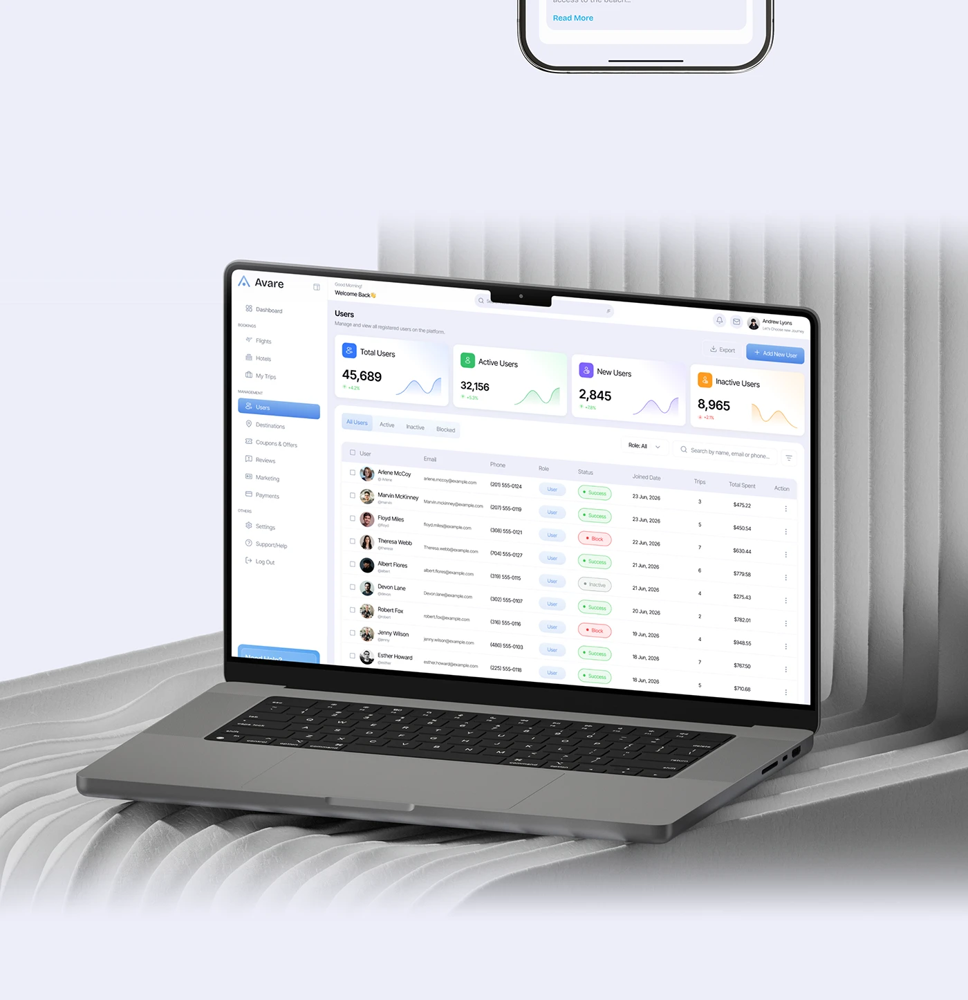

# Admin Dashboard Laptop on White Ribbed Forms

**Discipline:** web ·  · **Design style:** 3D & Surreal
**Tags:** laptop, dashboard, white, ribbed, lavender, admin, 3d

## What it is
A laptop tilted on a sculptural white ribbed surface showing a light admin users dashboard with KPI cards and a table, beneath a lavender panel with a phone edge.

## What it means
Sculptural white ribs give an architectural stage, and the pale UI melts into it for a calm premium feel.

## Techniques
- Ribbed 3D forms as a stage
- White and grey monochrome scene
- Laptop angled with soft shadows
- Coloured KPI cards as the only colour
- Lavender background around the render

## Best for
- Dashboard showcase renders
- SaaS admin UI presentations
- Neutral, premium scenes

## Vocabulary
- **Ribbed form** — A fluted 3D shape used as a backdrop.
- **Tonal scene** — An image kept to one colour family.
- **KPI card** — A card showing a key metric with a trend.
