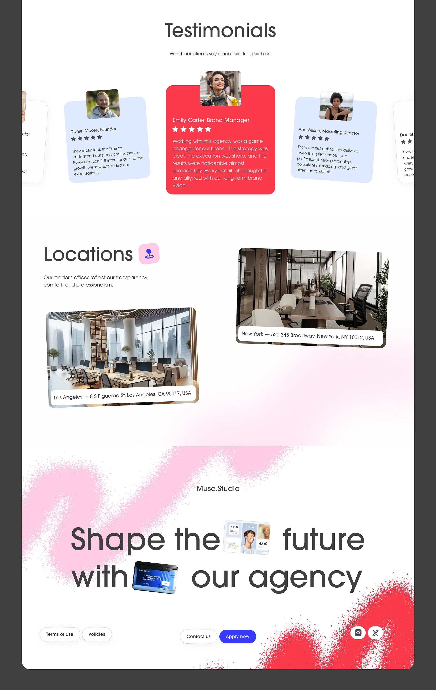

# Agency sections: tilted testimonial cards with a red centre card, office photo cards and a pink and red spray footer

**Discipline:** web ·  · **Design style:** Gradient & Aurora
**Tags:** agency, testimonials, tilted-cards, red, pink, spray, locations, inline-images

## What it is
A white page with 'Testimonials' and three tilted cards (pale blue, a large red centre card with a portrait tab, pale blue) with stars and quotes, 'Locations' with two tilted office photo cards with address captions, and a footer with a pink and red spray-paint texture, a large statement 'Shape the future with our agency' with inline images, pill links and social icons.

## What it means
Warm and lively; tilted cards and spray make testimonials feel human.

## Techniques
- Tilt cards and give the hero card a strong colour.
- Tuck portraits into card tops.
- Use spray-paint texture as a footer backdrop.
- Embed small images inside the closing headline.

## Best for
- Agency and studio sites
- Testimonial and location sections
- Playful light pages

## Vocabulary
- **Portrait tab** — A small photo tucked at the top of a card.
- **Spray footer** — A footer with paint-spray texture.
- **Address caption** — A white label over a photo giving a location.
- **Inline image** — A small picture inside a headline.
