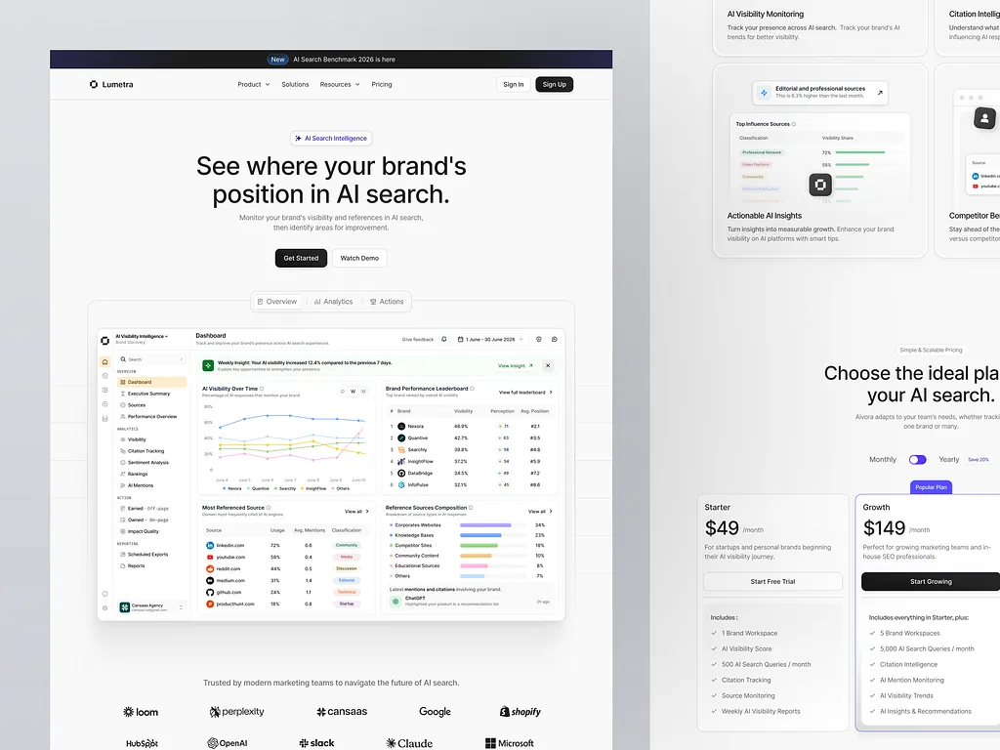

# White AI-visibility SaaS pages: centred headline, framed dashboard preview, logo row, feature cards and pricing

**Discipline:** web ·  · **Design style:** Corporate & Clean-Tech
**Tags:** saas, analytics, white, black-buttons, dashboard, feature-cards, pricing, logos

## What it is
Two white desktop pages: one with a tiny nav and banner, a centred 'See where your brand's position in AI search.' with black and outlined buttons, a framed dashboard with charts, leaderboards and source tables and a logo row; and a second with feature cards with mini UI previews and a two-tier pricing block with a Popular badge.

## What it means
Clean and credible; a large product preview under a plain headline sells the tool.

## Techniques
- Frame the product dashboard under the hero.
- Use tab pills above the preview.
- Show features as cards with mini UI.
- Highlight one pricing plan.

## Best for
- B2B analytics and AI SaaS
- White minimal landing pages
- Dashboard-led heroes

## Vocabulary
- **Framed preview** — A screenshot placed in a bordered frame.
- **Tab pills** — Pills labelled Overview, Analytics, Actions above a preview.
- **Feature card** — A card with a mini UI example.
- **Popular badge** — A tag on the recommended plan.
