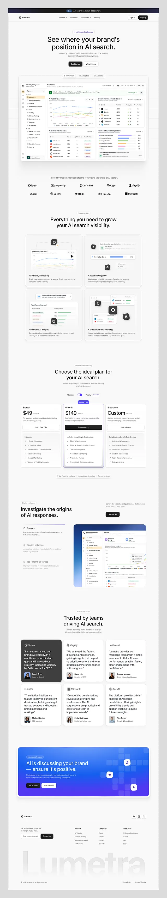

# Long white AI-visibility analytics landing page with dashboards and pricing

**Discipline:** web ·  · **Design style:** Corporate & Clean-Tech
**Tags:** saas, analytics, white, indigo, dashboard, logo-strip, pricing, testimonials, giant-footer-wordmark

## What it is
A tall white page with a centred headline 'See where your brand's position in AI search', a big dashboard screenshot, logos, a four-card feature grid, a three-tier pricing table, a section with a large screenshot on an indigo panel, a testimonial grid, an indigo gradient CTA panel, and a footer with an enormous faint wordmark.

## What it means
Clean, professional and data-forward; indigo panels punctuate a mostly white system.

## Techniques
- Lead with a real dashboard screenshot under a centred headline.
- Show a faint enormous wordmark at the footer.
- Use one indigo panel for the CTA and one for a feature.
- Present pricing as three cards with the middle emphasised.
- Grid of testimonial cards with logos.

## Best for
- B2B analytics and marketing tools
- AI SaaS
- Data-heavy products

## Vocabulary
- **Dashboard hero** — A hero built around a product screenshot.
- **Feature grid** — A grid of cards explaining capabilities.
- **Testimonial grid** — A grid of customer quotes with names and logos.
- **Ghost footer wordmark** — A giant low-contrast brand name in the footer.
