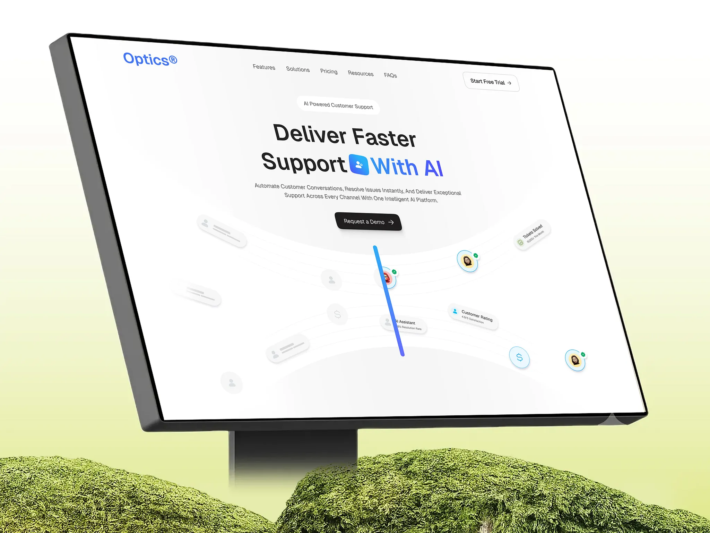

# Clean AI customer-support hero on a tilted monitor rising from moss in a green gradient

**Discipline:** web · **Design type:** Device mockup scene
**Tags:** mockup, monitor, moss, green, white-ui, blue-accent, ai, perspective

## What it is
A tilted monitor with a white AI-support page (blue keyword highlighted with an icon, dark button, floating avatar chips and a vertical blue bar) sits above mossy rocks against a white-to-lime gradient.

## What it means
Fresh and natural; moss makes software feel alive.

## Techniques
- Tilt the screen dramatically.
- Ground the monitor in moss.
- Colour a key word in the headline blue with an inline icon.
- Scatter faded UI chips on the page.

## Best for
- SaaS hero presentations
- Organic-tech contrast
- Case-study covers

## Vocabulary
- **Organic contrast** — A digital screen set in natural texture.
- **Inline icon** — A small icon inside a headline.
- **Faded chips** — Low-contrast decorative UI pieces.
- **Tilted monitor** — A screen shown in perspective.
