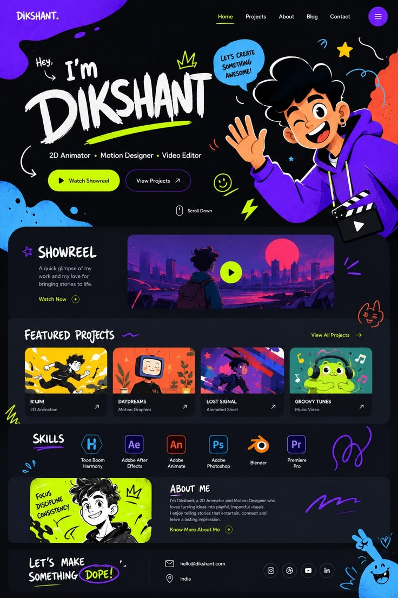

# Animator portfolio on black with neon lime, violet blobs and sketchy cartoon character

**Discipline:** web ·  · **Design style:** Playful & Illustrated
**Tags:** portfolio, dark, neon-lime, violet, illustration, doodles, cartoon, showreel, brush-type

## What it is
A tall dark portfolio page: hero with brush-lettered 'Dikshant', lime underline and pills, a waving cartoon character with a speech bubble, blobs of violet and blue, a showreel card, featured project tiles in bright illustrated colours, a skills row of software icons, an about card with a lime portrait and a contact footer with a sticker character. Hand-drawn doodles sit throughout.

## What it means
Energetic, youthful and fun; illustration and doodles give an animator's personality.

## Techniques
- Set the name in brush-marker lettering with a highlighter underline.
- Use neon lime and violet on near-black for maximum pop.
- Add small doodle marks between sections.
- Use rounded dark cards to hold different content types.
- Let an illustrated character interact with the hero text.

## Best for
- Animators, illustrators and motion designers
- Playful creative portfolios
- Youth-focused personal brands

## Vocabulary
- **Brush lettering** — Letters that look painted with a marker or brush.
- **Highlighter underline** — A thick coloured stroke under text.
- **Doodle scatter** — Small hand-drawn marks placed around a layout.
- **Dark card stack** — A page of stacked dark rounded panels.
