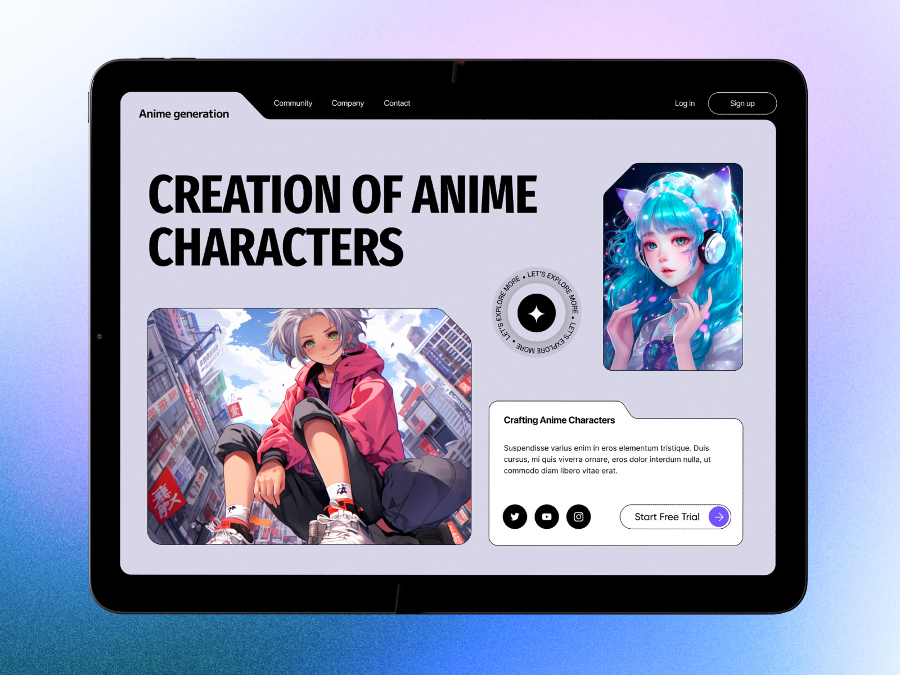

# Anime Generator Hero on a Tablet

**Discipline:** web · **Design type:** Landing page hero
**Tags:** tablet, anime, ai, notched-cards, circular-text, display-caps, lilac, gradient-backdrop

## What it is
A tablet on a grainy blue-to-lilac gradient showing a lilac-grey site with a black notched header, a huge condensed caps headline 'Creation of Anime Characters', an anime illustration in a clipped-corner frame, a portrait card, a rotating circular text badge with a sparkle, an info card with a tab and social icons and a Start Free Trial pill.

## What it means
Clipped corners and a circular badge give a techy, graphic layout, and vivid anime art contrasts with the neutral lilac.

## Techniques
- Clipped-corner frames and a tabbed card
- Condensed caps headline
- Circular text badge as a decorative call to action
- Vivid artwork against a muted ground
- Grain over the gradient backdrop

## Best for
- AI art and generator sites
- Bento-like hero layouts
- Tablet presentation mockups

## Vocabulary
- **Clipped corner** — A frame corner cut diagonally.
- **Circular text** — Text set around a circle as a badge.
- **Grain overlay** — Fine noise added over a gradient.
