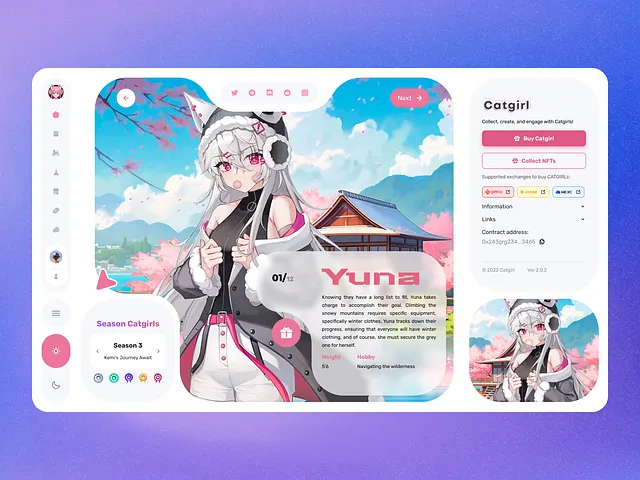

# Rounded white dashboard with a large anime character card, side icons and pink accents on violet

**Discipline:** web · **Design type:** Dashboard
**Tags:** dashboard, nft, anime, pink, white-ui, rounded, violet-gradient, illustration

## What it is
A blue-violet gradient with a large white rounded panel: left icon rail, a season selector card, a big character illustration in a notched rounded frame with a glass info card and pink name, and a right column with buy buttons, exchange chips and details.

## What it means
Playful and collectible; soft rounded corners and pink accents suit character culture.

## Techniques
- Frame an illustration in a notched rounded shape.
- Overlay a glass info panel with big pink name.
- Use pink for primary actions.
- Keep chrome white and rounded.

## Best for
- Collectible, gaming and NFT sites
- Character showcase pages
- Rounded playful dashboards

## Vocabulary
- **Notched frame** — A rounded frame with cut-in corners.
- **Icon rail** — A vertical strip of icons.
- **Glass info card** — A translucent panel of details.
- **Season selector** — A small card to switch a collection.
