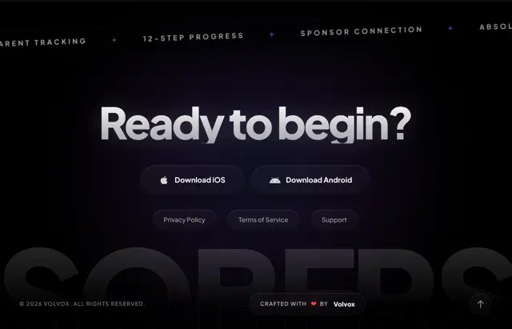

# Dark closing screen 'Ready to begin?' with a silver gradient headline, iOS and Android buttons, link pills, a tilted marquee and a giant ghost word

**Discipline:** web · **Design type:** Landing page hero
**Tags:** cta, dark, silver-gradient, download-buttons, marquee, ghost-word, footer, app

## What it is
A near-black page with a curved marquee of spaced small caps phrases at the top (parent tracking, 12-step progress, sponsor connection), a large white-to-silver gradient headline 'Ready to begin?', two dark rounded buttons for Download iOS and Android, three smaller pills (Privacy Policy, Terms of Service, Support), and at the bottom a giant faded word cropped by the frame with a copyright and a 'Crafted with ♥ by' pill and a scroll-up button.

## What it means
Polished and encouraging; a gradient headline and ghost word give a footer CTA a finish.

## Techniques
- Fill the headline with a silver gradient.
- Curve a marquee across the top.
- Use dark pill buttons for stores.
- Crop a giant ghost word at the bottom.

## Best for
- App landing page footers
- Dark closing CTAs
- Gradient-text headlines

## Vocabulary
- **Silver gradient text** — Letters filled with a white-to-grey blend.
- **Curved marquee** — A scrolling line of text following a curve.
- **Ghost word** — A giant faint word behind or below content.
- **Store buttons** — Dark pills for downloading from app stores.
