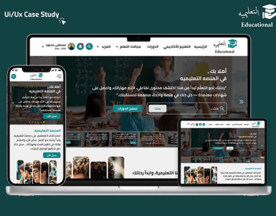

# Arabic educational platform UI/UX case study cover on laptop, tablet and phone

**Discipline:** web · **Design type:** Project cover · **Design style:** Corporate & Clean-Tech
**Tags:** education, arabic, rtl, responsive, dark-green, case-study-cover

## What it is
A light cover with a 'UI/UX Case Study' label and a mortarboard logo, showing an Arabic right-to-left learning site on a laptop, tablet and phone: a classroom hero photo with dark green overlay, green CTAs and course cards.

## What it means
Credible and accessible; three devices prove the RTL layout works everywhere.

## Techniques
- Show the same page on three devices.
- Use a photo hero with a brand-colour overlay.
- Label the cover as a case study in the corner.

## Best for
- Education platforms
- Arabic/RTL web projects
- Portfolio covers

## Vocabulary
- **RTL** — Right-to-left layout used for Arabic and Hebrew.
- **Responsive** — A design that adapts to different screen sizes.
