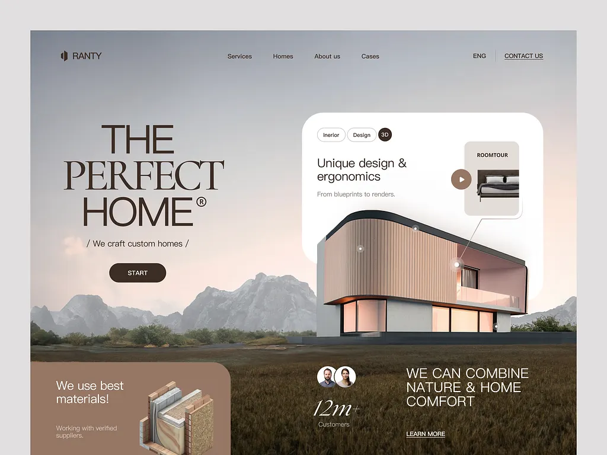

# Custom-home builder hero: giant taupe serif 'THE PERFECT HOME' over a mountain field, a white card with a rounded 3D house and a room-tour pill

**Discipline:** web ·  · **Design style:** Editorial
**Tags:** architecture, real-estate, serif, taupe, blush-sky, 3d-house, white-card, landscape

## What it is
A blush-grey sky and dark grass landscape inside a framed page with a thin nav and a Contact link, a huge dark taupe serif 'THE PERFECT HOME®' with 'We craft custom homes' and a dark pill START, a big white rounded card with tag pills, a 3D rounded wood-clad house with hotspot dots, a 'ROOMTOUR' preview tile and play button, a taupe card about materials with a wall cross-section, avatars with '12m+ customers' and a light statement 'WE CAN COMBINE NATURE & HOME COMFORT'.

## What it means
Warm and refined; taupe serif and a soft sunset sky feel like a calm luxury build.

## Techniques
- Set a giant serif title on a landscape photo.
- Overlay a white card holding a 3D model with hotspots.
- Use a taupe card with a cross-section illustration.
- Keep a warm blush and taupe palette.

## Best for
- Home builders and architecture studios
- Serif landscape heroes
- 3D model hero cards

## Vocabulary
- **Hotspot dot** — A dot marking an interactive point on a 3D model.
- **Room-tour tile** — A small preview with a play button.
- **Cross-section illustration** — A cutaway drawing of a wall.
- **Taupe serif** — A serif headline in muted brown-grey.
