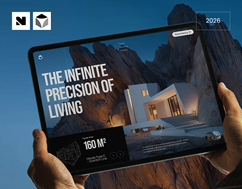

# Architecture Site Tablet Held against Blue Sky

**Discipline:** web ·  · **Design style:** Corporate & Clean-Tech
**Tags:** tablet, architecture, hands, blue, black-white-logos, hero, cover

## What it is
A cover with two hands holding a tablet whose screen shows a mountain house site with a large white headline 'The Infinite Precision of Living' and a black plan card, against a deep blue gradient, with two square logos and a 2026 tag.

## What it means
The tablet's dramatic rock photo becomes the cover's colour, and the deep blue frames it calmly.

## Techniques
- Held tablet filling most of the frame
- Photo hero with overlaid heading inside the UI
- Deep blue backdrop matched to the sky
- Logo squares and year tag in the corners
- Black spec card with plan drawing

## Best for
- Architecture and real estate sites
- Tablet covers
- Photo-led site presentations

## Vocabulary
- **Spec card** — A dark card listing area and type of a property.
- **Held tablet** — A tablet shown in hands at a slight angle.
- **Year tag** — A small outlined box giving the project year.
