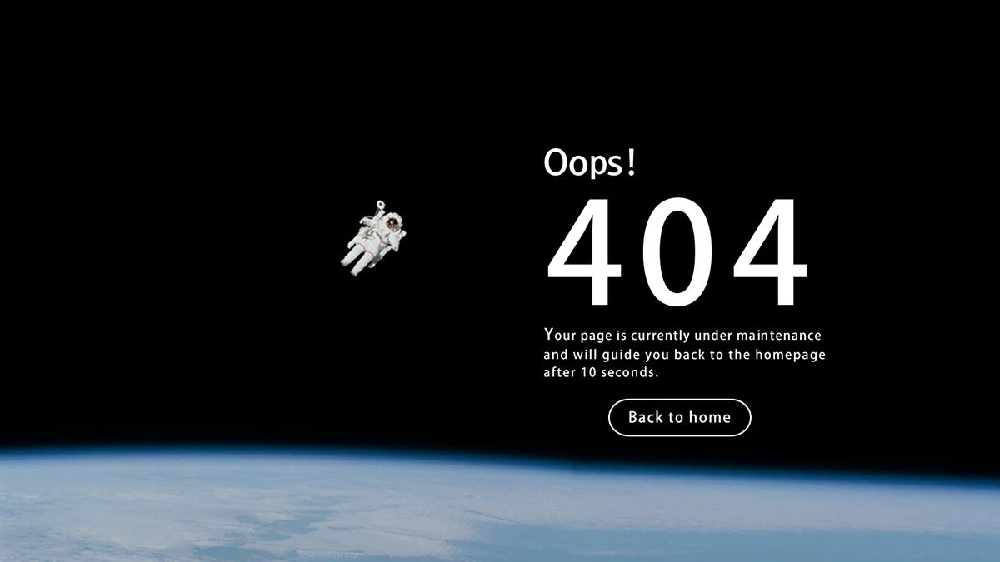

# Black space 404 with a floating astronaut, big white numerals, a small message and an outlined home pill

**Discipline:** web · **Design type:** Page section
**Tags:** 404, error-page, space, black, white, astronaut, earth, outlined-button

## What it is
A black space scene with a real photo of an astronaut floating at left, the Earth's curved edge along the bottom, a white 'Oops!' and giant wide-tracked '404', two lines of message and an outlined 'Back to home' pill.

## What it means
Vast and witty; being lost in space matches a lost page.

## Techniques
- Use a floating astronaut as a metaphor for lost.
- Curve Earth along the bottom.
- Set numerals in wide light letters.
- Use an outlined pill button.

## Best for
- Error and 404 pages
- Space-themed sites
- Metaphor-led empty states

## Vocabulary
- **Lost-in-space metaphor** — Using space imagery to express being lost.
- **Earth horizon** — The curved planet edge along the bottom.
- **Tracked numerals** — Widely spaced large digits.
- **Outlined pill** — A capsule with a border only.
