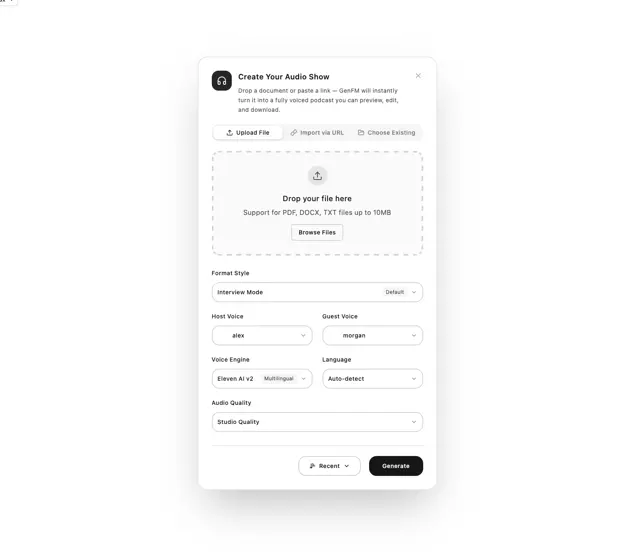

# White modal 'Create Your Audio Show' with an upload tab bar, dashed dropzone, format and voice selectors and a black Generate button

**Discipline:** web · **Design type:** UI components
**Tags:** component, modal, form, upload, dropzone, selects, white, black-button

## What it is
A white card with a dark round icon, a bold title and description, a three-tab bar (Upload File, Import via URL, Choose Existing), a dashed dropzone with an upload icon and Browse Files button, a Format Style select, paired Host and Guest voice selects, Voice Engine and Language selects, an Audio Quality select and a footer with a Recent dropdown and a black Generate button.

## What it means
Structured and approachable; grouped fields and one black action make a complex form feel simple.

## Techniques
- Use tabs for input source.
- Frame upload as a dashed dropzone.
- Pair related selects in two columns.
- End with one black primary button.

## Best for
- Upload and generate modals
- AI tool forms
- Settings-heavy dialogs

## Vocabulary
- **Dropzone** — A dashed area for dropping files.
- **Select field** — A dropdown input with a value.
- **Input tabs** — Tabs choosing how to provide content.
- **Primary black button** — A black button for the main action.
