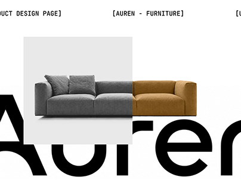

# Auren furniture product page: a sofa split grey/ochre over a giant black wordmark

**Discipline:** web · **Design type:** Product detail page · **Design style:** Editorial
**Tags:** furniture, sofa, editorial, typography, monospace, product-page

## What it is
A white layout with monospace bracketed labels '[Product Design Page]' and '[Auren - Furniture]', a huge black 'Auren' wordmark cropped at the edges, and a sofa whose left half is grey inside a pale square and right half ochre, showing colour options.

## What it means
Architectural and bold; the split sofa demonstrates choice in one striking image.

## Techniques
- Split a product image to show two variants.
- Crop a giant wordmark behind the product.
- Use bracketed monospace labels as captions.

## Best for
- Furniture e-commerce
- Product configurators
- Editorial web design

## Vocabulary
- **Variant** — A version of a product in another colour or size.
- **Cropped type** — Letters cut off by the frame edge.
