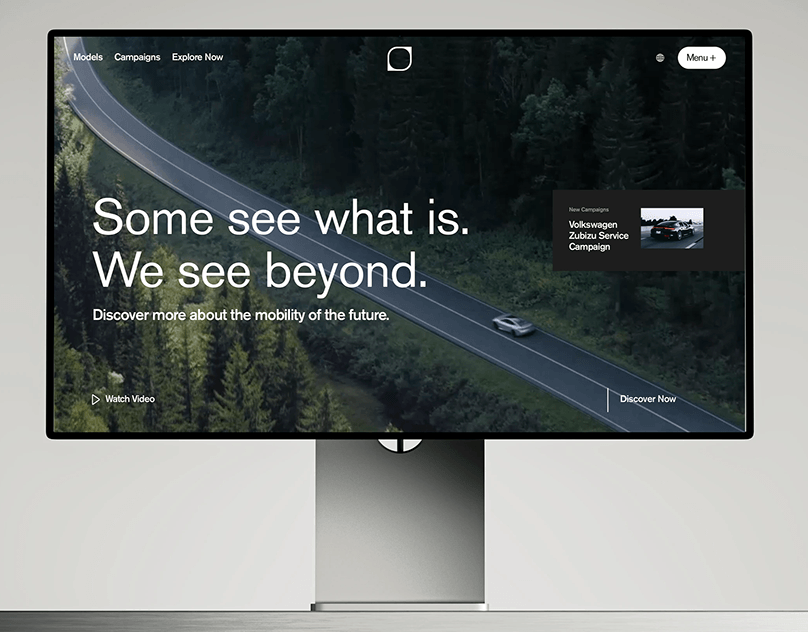

# Car-brand site on a monitor: aerial forest road, big white 'Some see what is. We see beyond.' and campaign card

**Discipline:** web · **Design type:** Device mockup scene
**Tags:** automotive, monitor, forest, white-type, aerial, video-hero, minimal, campaign-card

## What it is
A monitor on a metal stand showing a full-bleed aerial forest road with a car, a minimal nav with a logo square and a white Menu pill, a large white two-line statement, a Watch Video link, Discover Now and a small dark campaign card with a car thumbnail.

## What it means
Cinematic and premium; sparse type over a moody drive feels like a car film.

## Techniques
- Use a full-bleed aerial video hero.
- Set a big two-line statement in white.
- Add a small dark card in the corner.
- Keep navigation minimal.

## Best for
- Automotive and mobility brands
- Cinematic video heroes
- Minimal luxury sites

## Vocabulary
- **Aerial hero** — A hero using drone footage.
- **Statement headline** — A two-line contrasting sentence.
- **Campaign card** — A small card promoting a campaign.
- **Monitor stand** — A display shown on a stand.
