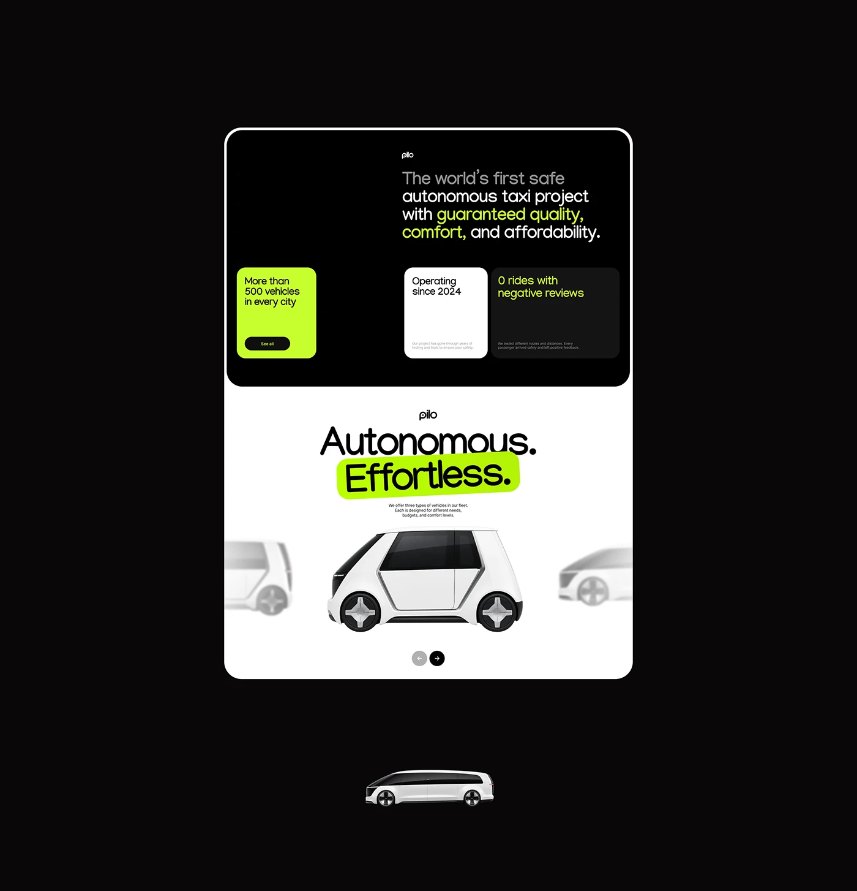

# Autonomous taxi site: black stats block and white vehicle slider with lime highlight

**Discipline:** web · **Design type:** Landing page sections
**Tags:** landing-page, autonomous, black-and-white, lime, stats-cards, slider, rounded-frame, vehicles

## What it is
A rounded framed page on black with two sections: a black one with a two-tone statement and three stat cards (lime, white, dark), and a white one with the headline 'Autonomous. Effortless.' where the second word has a lime marker highlight above a centred white van with blurred neighbouring vehicles and arrow buttons. A single vehicle render sits below the frame.

## What it means
Clean and confident; the lime highlight and blurred neighbours give a modern, focused product carousel.

## Techniques
- Highlight a headline word with a tilted lime marker block.
- Use three stat cards in different fills (lime, white, dark) as a set.
- Blur the previous and next slides in a carousel to show depth.
- Flip from a black section to a white one within one rounded frame.

## Best for
- Mobility, hardware and product-led landing pages
- Sites with vehicle or product carousels
- Bold black, white and neon brands

## Vocabulary
- **Marker highlight** — A coloured block behind a word, like highlighter pen.
- **Blurred neighbour** — Adjacent carousel items shown out of focus.
- **Stat card** — A card with a key fact.
- **Section flip** — Switching between dark and light sections.
