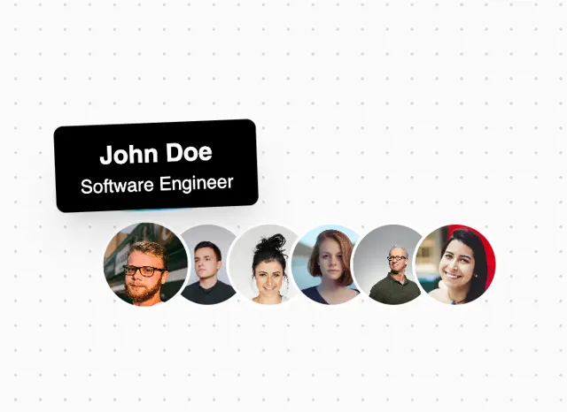

# Overlapping round avatars with a black rounded tooltip 'John Doe, Software Engineer' above the first

**Discipline:** web ·  · **Design style:** Dark & Neon
**Tags:** component, avatars, tooltip, black, white, dotted, team, hover

## What it is
A dotted white frame with six overlapping circular portraits with white rings and a black rounded rectangle tooltip with bold white name and lighter title above the first avatar.

## What it means
Friendly and compact; a stack shows a team and the tooltip reveals who on hover.

## Techniques
- Overlap avatars with white rings.
- Reveal identity in a black tooltip.
- Keep the tooltip high-contrast.
- Use a dotted background.

## Best for
- Team and contributor lists
- Hover tooltip components
- Social proof rows

## Vocabulary
- **Avatar stack** — Overlapping round profile images.
- **Tooltip** — A small label appearing on hover.
- **Ring border** — A white outline separating overlapping images.
- **Name and role** — Bold name over a lighter job title.
