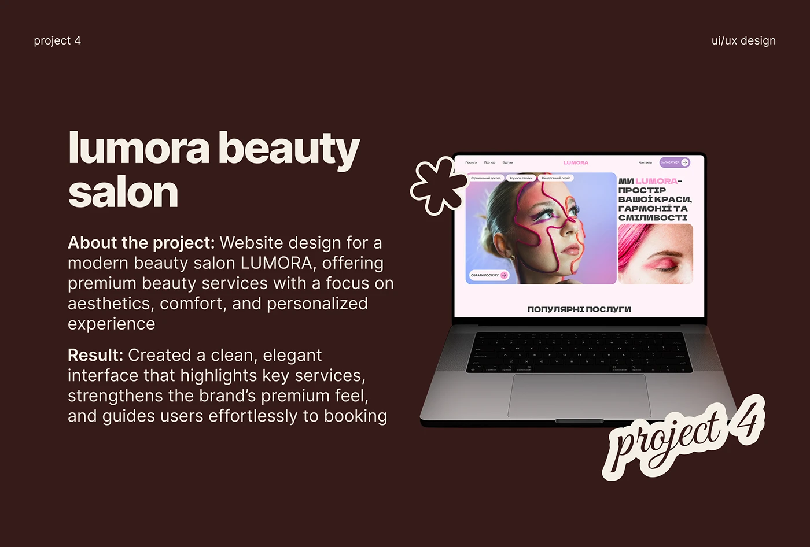

# Salon website case study on chocolate brown with cream sticker labels

**Discipline:** web · **Design type:** Case study slide
**Tags:** case-study, beauty, chocolate-brown, cream, sticker, laptop-mockup, script

## What it is
A deep brown slide with a large cream two-line title, a project description and result paragraph in bold-led lines, and a laptop showing a pink beauty-salon site. A cream outline-sticker script 'project 4' and a floral asterisk sticker overlap the laptop.

## What it means
Warm, sweet and confident; brown-and-cream framing lets a pastel site shine.

## Techniques
- Frame a pastel website on a dark chocolate background for contrast.
- Use bold lead-ins ('About the project:', 'Result:') in a text block.
- Add outlined script stickers that overlap the device.
- Keep top-corner labels tiny.

## Best for
- Web-design portfolio case study slides
- Beauty and lifestyle sites
- Designers wanting an editorial presentation

## Vocabulary
- **Bold lead-in** — A bold phrase at the start of a paragraph.
- **Outline sticker** — Text with a thick contrasting border, like a die-cut sticker.
- **Dark stage** — A dark background used to make light work stand out.
- **Laptop mockup** — A laptop frame displaying a website.
