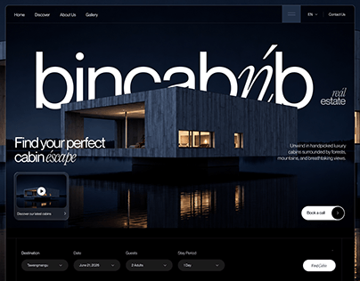

# bincabnb cabin real estate hero: a lit modern cabin at night over water behind a giant wordmark

**Discipline:** web · **Design type:** Landing page hero · **Design style:** Photographic & Cinematic
**Tags:** real-estate, cabin, night, luxury, booking, serif

## What it is
A dark blue night hero with a huge white 'bincabnb' wordmark partly behind a glowing modern cabin reflected in water, 'Find your perfect cabin escape' with an italic serif word, a video card, 'Book a call' button and a booking bar (destination, date, guests, stay period, Find Cabin).

## What it means
Moody and exclusive; the warm windows in the dark promise a cosy escape.

## Techniques
- Place the hero subject in front of a giant wordmark.
- Mix sans and italic serif in the headline.
- Anchor a booking bar at the bottom of the hero.

## Best for
- Luxury rentals
- Real estate
- Hospitality booking sites

## Vocabulary
- **Depth layering** — Placing objects in front of and behind type.
- **Booking bar** — A horizontal search form for reservations.
