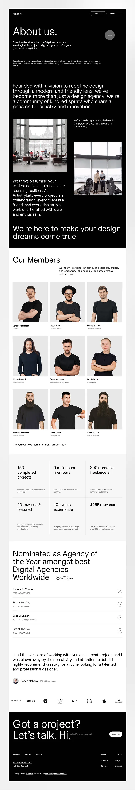

# Black and white agency about page: big light paragraph, team photo grid in black tees, stats, awards list, testimonial and footer form

**Discipline:** web · **Design type:** Page section
**Tags:** agency, about-page, black, white, team-grid, stats, awards, minimal

## What it is
A tall page with a black top half (nav, 'About us.' title, small copy, a large light paragraph and two office photos) and a white lower half: 'Our Members' with a 3x3 grid of grey portrait photos in black tops, a stats grid, 'Nominated as Agency of the Year' with an award list, a testimonial with logos and a black footer 'Got a project? Let's talk. Hi,' with an inline name field.

## What it means
Confident and quiet; big light type and uniform portraits feel like a serious studio.

## Techniques
- Set a large light paragraph as the manifesto.
- Shoot the team in uniform black on grey.
- Use an inline form field in the footer headline.
- Show awards as a hairline list.

## Best for
- Agency and studio about pages
- Team grid sections
- Black and white minimal sites

## Vocabulary
- **Manifesto paragraph** — A large statement of purpose.
- **Uniform portraits** — Team photos with the same crop, colour and backdrop.
- **Awards list** — Titles with year and body on hairlines.
- **Inline form field** — An input placed inside a headline.
