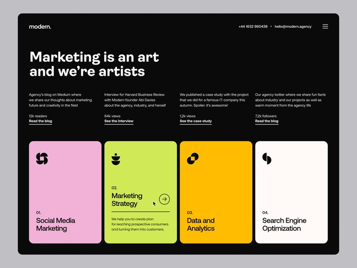

# Black Agency Page with Four Colour Service Cards

**Discipline:** web ·  · **Design style:** Dark & Neon
**Tags:** agency, black, pink, lime, orange, cards, icons, marketing

## What it is
A black rounded page with a nav, a big white headline 'Marketing is an art and we're artists', four short blurbs with underlined links and four tall service cards in pink, lime, orange and cream with black glyph icons and numbered titles, the lime one expanded with a description.

## What it means
Bright cards on black feel bold and creative, and a single expanded card shows interaction.

## Techniques
- Four saturated cards on a black ground
- Simple black glyph icons in each card
- Numbered service titles
- One card expanded to show hover state
- Underlined text links under blurbs

## Best for
- Agency and studio sites
- Service overviews
- Colourful cards on dark backgrounds

## Vocabulary
- **Service card** — A card describing one offered service.
- **Hover state** — The look of an element when the pointer is over it.
- **Glyph icon** — A simple abstract symbol used as an icon.
