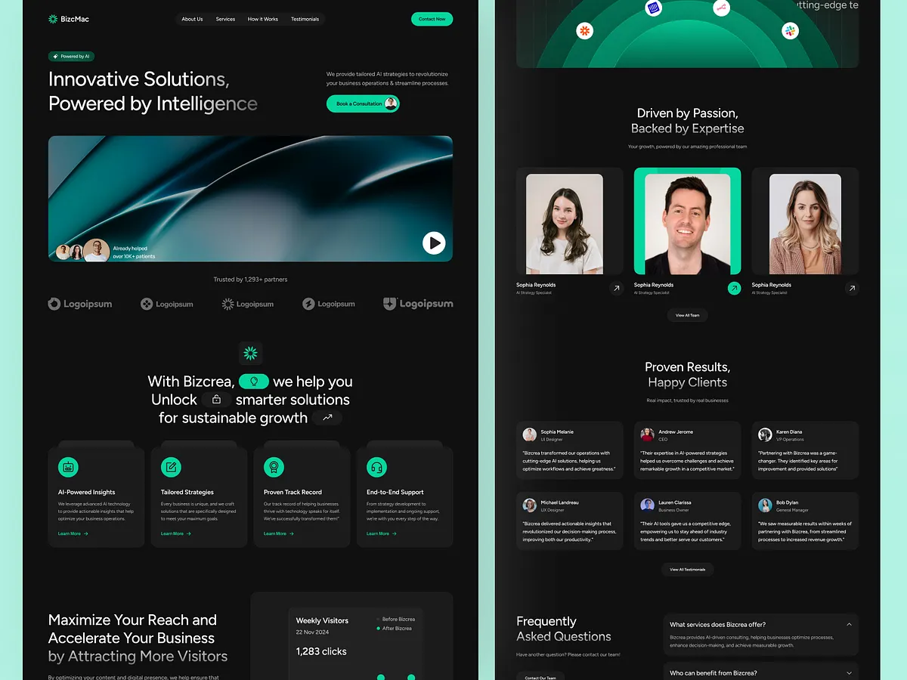

# Two-column overview of the AI consulting site on mint: hero, services, team and testimonials

**Discipline:** web ·  · **Design style:** Minimalist
**Tags:** ai, consulting, black, emerald, two-column, overview, pill-nav, mint-backdrop

## What it is
A mint background with two black page columns: the top of the site with the pill nav, hero headline, video image, logo strip, an inline-pill headline and four service cards, and the lower part with nested arcs, a team trio with the middle card highlighted, testimonial cards and an FAQ.

## What it means
Sleek and calm; the mint backdrop makes the black pages glow.

## Techniques
- Show one long page as two columns.
- Use a pale mint backdrop for black pages.
- Repeat rounded dark cards.
- Keep emerald as the single accent.

## Best for
- Website overviews
- Dark UI presentation boards
- Emerald accent brands

## Vocabulary
- **Two-column overview** — A long page split across two columns.
- **Mint backdrop** — A pale green presentation background.
- **Service card** — A dark card with an icon and description.
- **Video hero** — A hero built around a video still.
