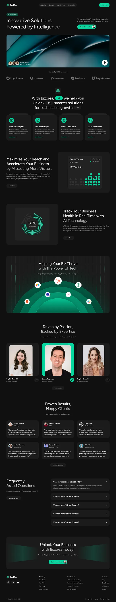

# Very long black site with emerald buttons: video hero, logo strip, service cards, dot bar chart, radial gauge, arc diagram, team and testimonials

**Discipline:** web · **Design type:** SaaS landing page
**Tags:** ai, consulting, black, emerald, dot-chart, radial-gauge, arcs, testimonials

## What it is
A tall black page with a pill nav and emerald CTA, a headline 'Innovative Solutions, Powered by Intelligence' fading to grey, a rounded video hero of a teal fabric-like abstract, a logo strip, a centred headline with inline emerald icon pills, four service cards with emerald icons, a dot-matrix bar chart, an 80% radial gauge made of lines, nested emerald arcs with app icons, a team trio with the middle card in emerald, six testimonial cards, a FAQ, a CTA band and a footer.

## What it means
Techy and premium; emerald on black with dot and line graphics feels precise.

## Techniques
- Inline emerald icon pills within a headline.
- Draw charts from dots and radial lines.
- Show integrations on nested arcs.
- Highlight the middle team card in emerald.

## Best for
- AI consulting and SaaS sites
- Black and emerald brands
- Dot and line data graphics

## Vocabulary
- **Inline icon pill** — A small pill with an icon inside a headline.
- **Radial line gauge** — A gauge made of many short radial lines.
- **Nested arcs** — Concentric semicircles carrying icons.
- **Highlight card** — One card in an accent colour among dark ones.
