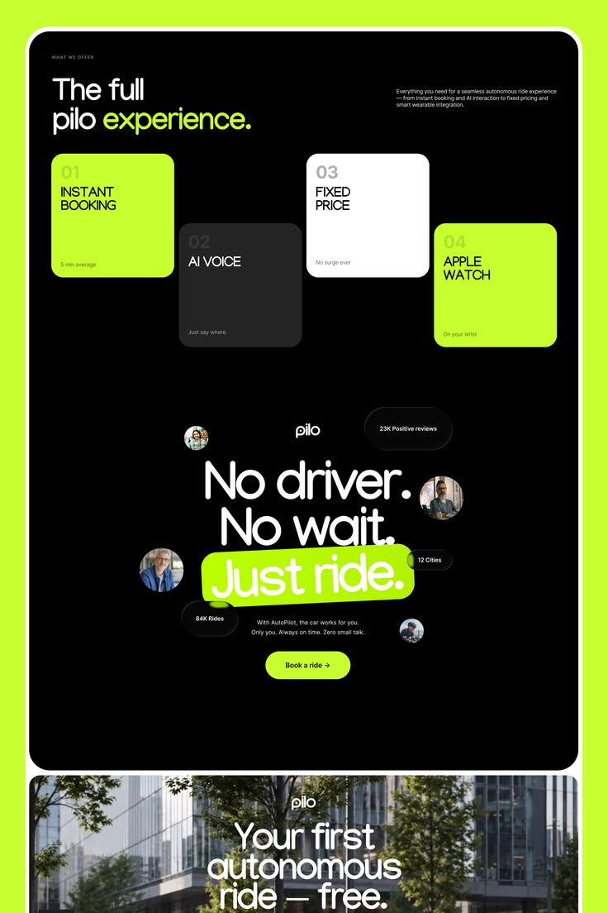

# Black and Lime Autonomous Ride Landing

**Discipline:** web ·  · **Design style:** Dark & Neon
**Tags:** black, lime, rounded, bento, cards, ride, pill-highlight, tall-page

## What it is
A tall landing page collage on lime: a black rounded panel with numbered feature cards staggered in lime, white, grey, then a centered slogan 'No driver. No wait. Just ride.' surrounded by avatar bubbles and stats, and a photo hero below.

## What it means
Black and neon lime feel bold, futuristic and fast. Staggered cards and floating stat pills add rhythm.

## Techniques
- Lime highlight block behind the key words of a slogan
- Staggered numbered cards forming a stair pattern
- Floating avatar circles and stat pills around a headline
- Full lime outer frame around a black rounded page
- Rounded, slightly quirky display type

## Best for
- Mobility and AI products
- Startups with an energetic voice
- Tall scrolling page presentations

## Vocabulary
- **Highlight block** — A solid coloured shape behind selected text.
- **Stair stagger** — Cards placed at alternating heights forming steps.
- **Stat pill** — A small rounded badge holding a number and label.
