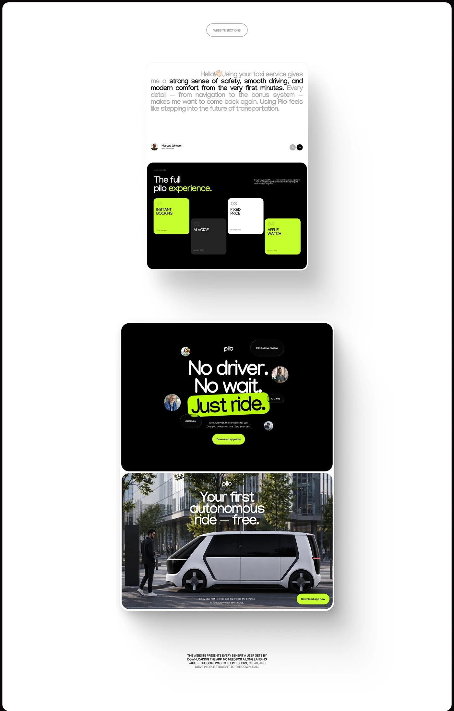

# Website sections: grey testimonial card, black feature tiles in lime, and a centred 'No driver. No wait.' hero

**Discipline:** web · **Design type:** Page section
**Tags:** sections, black, lime, tiles, testimonial, hero, full-bleed-photo, ride-hailing

## What it is
A white board of stacked page sections: a large-text testimonial with partial grey dimming and a black nav arrows pill; a black block 'The full pilo experience' with staggered lime, grey and white tiles; a black hero with a lime marker highlight on 'Just ride.' and avatar bubbles; and a full-bleed photo section with an autonomous van and lime button.

## What it means
Bold and modern; lime highlights cut through black.

## Techniques
- Mark one phrase with a lime highlighter block.
- Stagger colourful numbered tiles.
- Orbit small avatar bubbles around a headline.
- Switch from black to a full-bleed photo.

## Best for
- Ride-hailing and mobility sites
- Short download-focused pages
- Black and lime brands

## Vocabulary
- **Highlighter phrase** — Text on a bright marker-like block.
- **Avatar orbit** — Small portraits floating around a title.
- **Staggered tiles** — Tiles at different heights.
- **Dimmed testimonial** — A quote with part in grey.
