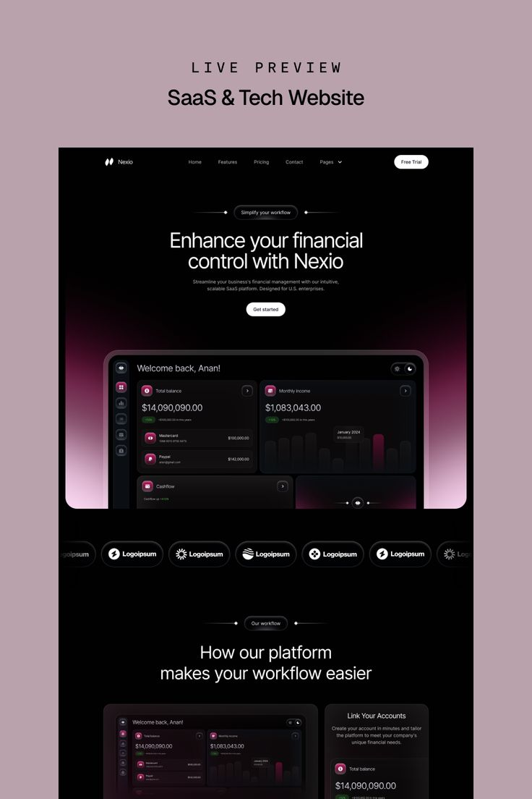

# Black finance SaaS template with a magenta glow behind a dashboard, logo pills and workflow cards on a dusty mauve board

**Discipline:** web ·  · **Design style:** Corporate & Clean-Tech
**Tags:** saas, dark, magenta, gradient-glow, dashboard, logo-strip, template, pill-nav

## What it is
A mauve board with 'LIVE PREVIEW SaaS & Tech Website' and a black page: a pill nav, a headline 'Enhance your financial control with Nexio' with a decorated pill label, a dashboard preview glowing with a magenta-to-pink gradient, a row of pill-shaped logos, a section 'How our platform makes your workflow easier' and dashboard cards.

## What it means
Sleek and premium; a magenta glow lifts a black dashboard without adding clutter.

## Techniques
- Glow a gradient behind the dashboard.
- Show logos as dark pills.
- Use decorated label pills with small lines and diamonds.
- Keep white type on black.

## Best for
- Fintech and SaaS templates
- Dark hero previews
- Magenta-glow brands

## Vocabulary
- **Dashboard glow** — A coloured bloom behind a UI preview.
- **Logo pill** — A logo inside a capsule.
- **Decorated label** — A pill flanked by small lines and dots.
- **Template preview** — An overview of a website template.
