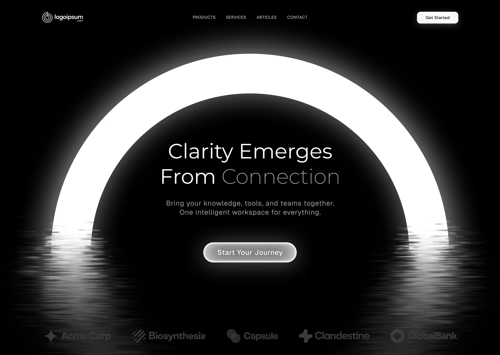

# Monochrome hero with a glowing white arch reflected in rippled water and a glass CTA

**Discipline:** web ·  · **Design style:** Glassmorphism
**Tags:** hero, dark, monochrome, arch, glow, reflection, glass-button, light-type

## What it is
A black hero with a huge glowing white arch whose lower ends dissolve into horizontal ripples. Centred inside are a thin light-weight headline 'Clarity Emerges From Connection', a grey paragraph, a glowing glass 'Start Your Journey' button and a faded logo strip at the bottom.

## What it means
Calm, majestic and meditative; an arch and reflection suggest a gateway.

## Techniques
- Use one glowing geometric arch as the entire visual.
- Stretch its base into water-like ripples.
- Set light thin headline type inside the arch.
- Make the CTA a glowing glass pill.
- Fade logos into the dark.

## Best for
- AI and productivity landing pages
- Premium dark heroes
- Brands promising clarity

## Vocabulary
- **Glow arch** — A bright curved band used as a portal.
- **Ripple reflection** — Horizontal streaks mimicking water reflection.
- **Glass button** — A translucent glowing button.
- **Faded logo strip** — Low-contrast partner logos.
