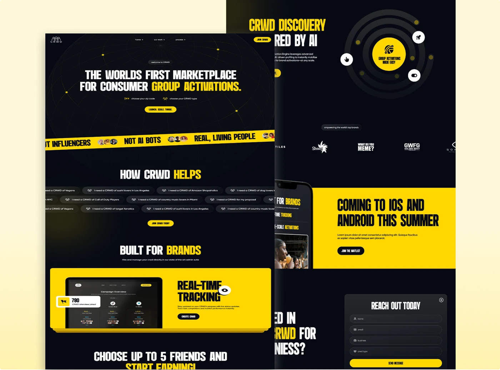

# Black-and-yellow crowd marketplace pages with globe lines, tape ticker, chip cloud and yellow feature blocks

**Discipline:** web · **Design type:** Landing page
**Tags:** marketplace, black, yellow, condensed-type, tape, chips, laptop-screen, form

## What it is
Two overlapping desktop pages: a black hero with globe lines and a headline 'THE WORLD'S FIRST MARKETPLACE FOR CONSUMER GROUP ACTIVATIONS.', a yellow tape ticker, chip cloud, 'BUILT FOR BRANDS' with a yellow tracking block; and a second page with a radial orbit graphic, logos, a yellow 'coming to iOS' block and a dark contact form.

## What it means
Loud and urban; yellow on black feels like live activation.

## Techniques
- Yellow tape ticker across the hero.
- Radial orbit graphic as a feature visual.
- Yellow full-width feature blocks.
- Condensed uppercase headlines.

## Best for
- Marketplace and community platforms
- Youth brands
- Black and yellow sites

## Vocabulary
- **Orbit graphic** — Concentric rings with nodes.
- **Tape ticker** — A diagonal strip of slogans.
- **Feature block** — A yellow block presenting one benefit.
- **Chip cloud** — Many small option pills.
