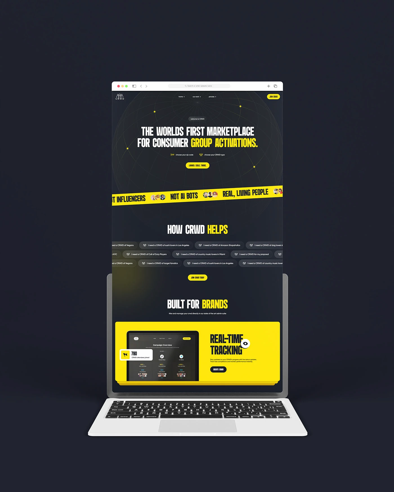

# Tall black-and-yellow page scrolling out of a laptop screen on a dark navy field

**Discipline:** web · **Design type:** Device mockup scene
**Tags:** marketplace, black, yellow, condensed-type, tape, laptop, tall-scroll, mockup

## What it is
A laptop on dark navy with a browser window taller than the screen showing the tape-ticker hero, chip cloud, 'BUILT FOR BRANDS' heading and a yellow real-time tracking block extending beyond the frame.

## What it means
Bold and clear; extending the page above the laptop shows the whole flow.

## Techniques
- Let the page extend above the laptop.
- Use a dark navy stage.
- Keep yellow as the only bright colour.
- Show the browser chrome.

## Best for
- Long page showcases
- Black and yellow sites
- Laptop scroll mockups

## Vocabulary
- **Overflow mockup** — A page that extends past its device.
- **Browser chrome** — The frame and toolbar of a browser.
- **Yellow feature block** — A bright block presenting a feature.
- **Navy stage** — A dark blue background.
