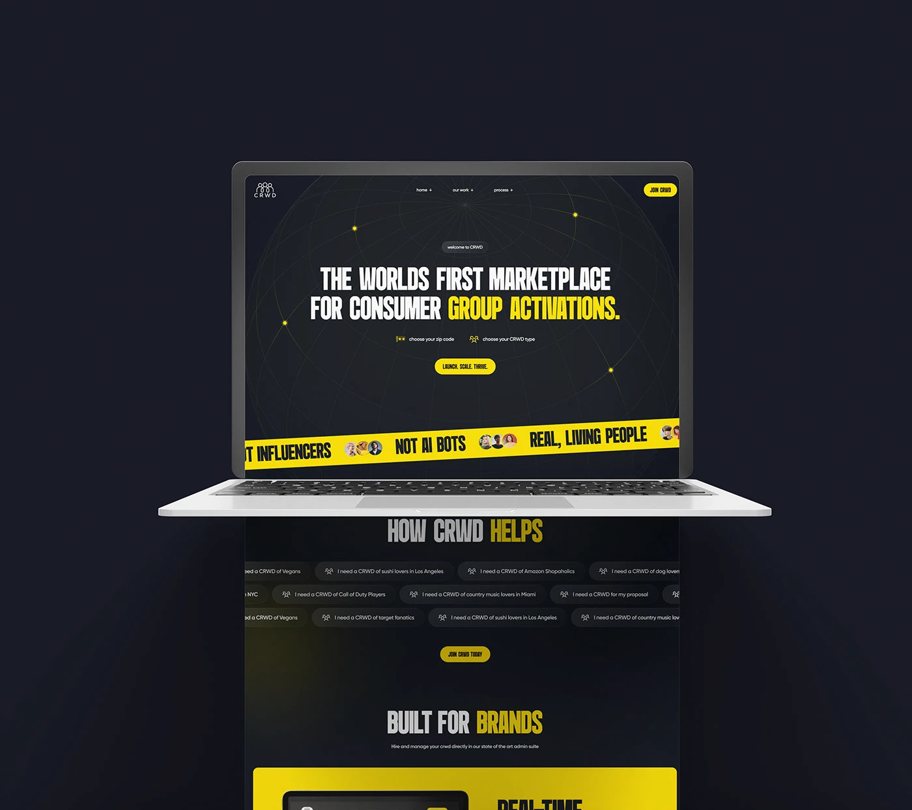

# Dark marketplace site with a yellow caution-tape ticker and condensed headlines

**Discipline:** web ·  · **Design style:** Dark & Neon
**Tags:** landing-page, dark, yellow, condensed-type, caution-tape, marquee, globe-lines, marketplace

## What it is
A laptop floating above a continuing screen. The dark navy hero has thin globe lines with yellow dots, a condensed white and yellow headline, small pills, a yellow CTA, and a diagonal yellow tape ticker of avatars and slogans. Below are chips of use cases and a bright yellow product block.

## What it means
Loud, urban and busy; yellow tape reads like a live activation.

## Techniques
- Set a diagonal yellow tape strip as a ticker across the hero.
- Use tall condensed uppercase with yellow emphasis words.
- Add faint globe or network lines as a background pattern.
- Pour a chip cloud of example use cases under the hero.
- Let the page extend out of the laptop to show length.

## Best for
- Marketplaces and campaign-based platforms
- Youth and social brands
- Bold black and yellow identities

## Vocabulary
- **Tape ticker** — A tilted band with repeating slogans, like caution tape.
- **Chip cloud** — A collection of small tags showing example queries.
- **Globe lines** — Fine lines suggesting a wireframe globe.
- **Overflowing mockup** — A page that continues beyond the device frame.
