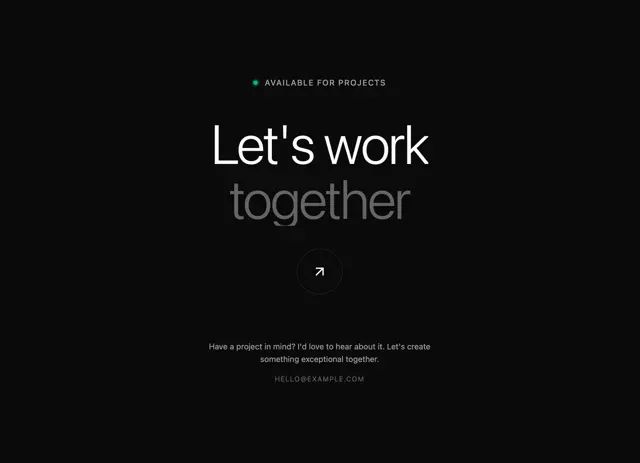

# Black closing hero 'Let's work together' in light sans with the second word faded, a green availability dot and a circular arrow button

**Discipline:** web ·  · **Design style:** Minimalist
**Tags:** contact, dark, light-sans, two-tone, availability, arrow-button, minimal, portfolio

## What it is
A black page with a small caps line with a green dot 'AVAILABLE FOR PROJECTS', a very large light white 'Let's work' above a grey faded 'together', a thin circular button with a diagonal arrow, a grey invitation paragraph and an email address in small caps.

## What it means
Quiet and confident; a faded second word and a tiny green dot make an invitation feel calm.

## Techniques
- Fade the second line of a big light headline.
- Use a small green availability dot.
- Add a thin circular arrow button.
- Keep contact in small caps.

## Best for
- Portfolio and freelancer contact sections
- Dark minimal closing sections
- Light-weight large type

## Vocabulary
- **Availability dot** — A green dot signalling open for work.
- **Faded second line** — A headline line in lower contrast.
- **Circular arrow button** — A ring button with a diagonal arrow.
- **Small-caps contact** — An email set in tiny uppercase.
