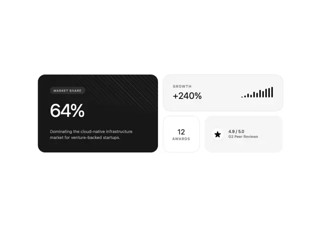

# Bento of stat tiles: a black '64% MARKET SHARE' card with diagonal streaks, a '+240% GROWTH' card with rising bars, a '12 AWARDS' tile and a '4.9 / 5.0' star tile

**Discipline:** web · **Design type:** Data visualization
**Tags:** stats, bento, black, white, grey, bars, star, tiles

## What it is
A white page with four rounded tiles: a large black tile with a small pill 'MARKET SHARE', a big white '64%' and a grey line, faint diagonal streaks in its corner, a pale grey wide tile 'GROWTH +240%' with ten rising black bars, a small white tile '12 AWARDS' and a light grey tile with a black star and '4.9 / 5.0 G2 Peer Reviews'.

## What it means
Confident and compact; different tile shades rank the numbers by importance.

## Techniques
- Give the key stat a black tile.
- Use rising bars as a micro chart.
- Combine small tiles with icons.
- Keep everything monochrome.

## Best for
- Company stat sections
- Bento stat tiles
- Monochrome metrics

## Vocabulary
- **Hero stat tile** — The largest tile with the key number.
- **Micro bars** — A tiny bar chart beside a number.
- **Award tile** — A small tile with a count and label.
- **Rating tile** — A tile with a star and score.
