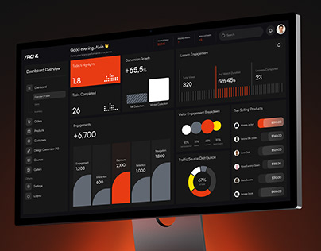

# Black and Orange Analytics Dashboard on Monitor

**Discipline:** web · **Design type:** Dashboard
**Tags:** dashboard, black, orange, monitor, charts, bento, glow

## What it is
A dark monitor showing a black analytics dashboard with orange highlight cards, stacked bar charts, donut charts and product lists, against a black background with an orange glow at the base.

## What it means
Orange on black feels energetic and technical, and the varied chart types keep a dense screen scannable.

## Techniques
- Orange accent cards among dark tiles
- Mixed chart types (bars, donuts, dotted bars)
- Bento of different-size widgets
- Orange glow beneath the monitor
- Minimal sidebar with small labels

## Best for
- Analytics dashboards
- Dark data products
- Bold accent dashboard presentations

## Vocabulary
- **Bento widget** — A dashboard tile of one size holding one visual.
- **Accent card** — A card filled with the accent colour to lead the eye.
- **Base glow** — A coloured light rising from the bottom edge.
