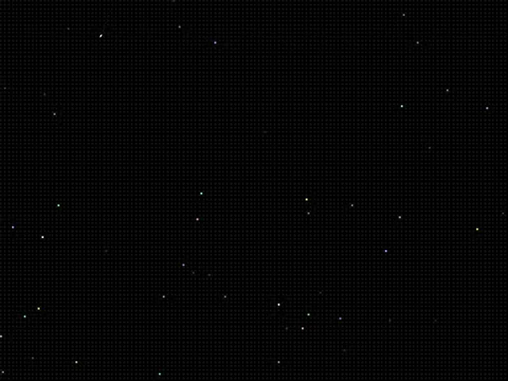

# Black pixel-grid night sky with scattered tiny white, blue and pink stars and one shooting streak

**Discipline:** web · **Design type:** Background pattern
**Tags:** background, stars, dark, starfield, pixel, minimal, space, particles

## What it is
A near-black canvas covered by a very faint square pixel grid with scattered single-pixel stars in white, pale blue and pink, and a short diagonal streak at the upper left.

## What it means
Quiet and expansive; a few stars make emptiness feel like space.

## Techniques
- Scatter sparse single-pixel stars.
- Add a faint pixel grid.
- Include one shooting streak.
- Keep the base near black.

## Best for
- Space and night hero backgrounds
- Dark pixel textures
- Particle-field backdrops

## Vocabulary
- **Starfield** — A background of scattered small stars.
- **Pixel grid** — A faint grid of square pixels.
- **Shooting streak** — A short diagonal line suggesting a meteor.
- **Sparse particles** — A few well-spaced points on a dark field.
