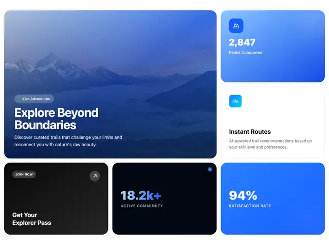

# Blue-toned bento: a large misty-mountain hero card, a blue gradient stat tile, a white feature card, a black CTA tile, a dark community stat and a bright blue 94% tile

**Discipline:** web ·  · **Design style:** Geometric & Bauhaus
**Tags:** bento, blue, black, white, photo-card, stats, gradient, cta

## What it is
A bento of rounded tiles: a big blue-tinted photo card of mountains and mist with a 'Live Adventures' pill and 'Explore Beyond Boundaries', a top-right blue gradient tile '2,847 Peaks Conquered' with an icon, a white 'Instant Routes' card, a black 'Get Your Explorer Pass' tile with a JOIN NOW pill and arrow, a near-black tile '18.2k+ ACTIVE COMMUNITY' in blue numerals with a corner dot and a saturated blue tile '94% SATISFACTION RATE'.

## What it means
Crisp and lively; a blue, black and white palette makes stats and photography read as one brand.

## Techniques
- Tint a photo tile in the brand blue.
- Use bright and dark tiles for stats.
- Mix white feature cards with colour tiles.
- Add small pills and icon squares.

## Best for
- Outdoor and travel platforms
- Bento hero sections
- Blue stat tiles

## Vocabulary
- **Tinted photo tile** — A photo card overlaid with a brand colour.
- **Stat tile** — A tile with a large figure and label.
- **CTA tile** — A tile inviting an action.
- **Bento hero** — A hero built from mixed-size tiles.
