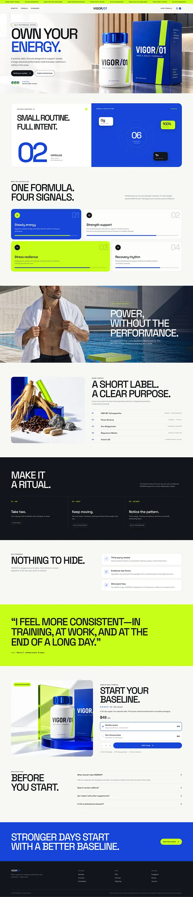

# Men's supplement page in royal blue, electric lime and white with condensed headlines, numbered cards and a giant testimonial

**Discipline:** web · **Design type:** E-commerce landing page
**Tags:** supplements, royal-blue, lime, white, condensed-type, numbered-cards, testimonial, long-scroll

## What it is
A very tall page with a ticker strip, hero 'OWN YOUR ENERGY.' with a blue keyword and a blue box beside a bottle, a white and blue split with a giant '02' and a formula panel, four numbered feature cards in blue, white, lime and white, a swimming-pool photo section with a big white statement, an ingredients photo and list, a dark ritual section, a white 'nothing to hide' section, a full lime testimonial band, a buy box, FAQ, a blue CTA band and a dark footer.

## What it means
Confident and clinical; blue, lime and white bands give a sports-lab feel.

## Techniques
- Alternate full-width blue, lime, white and dark bands.
- Set giant condensed headlines.
- Use a big numeral as a graphic.
- Give a full-width band to one testimonial.

## Best for
- Performance supplement pages
- Single-product long pages
- Blue-lime brands

## Vocabulary
- **Colour band** — A full-width section in one colour.
- **Numbered feature card** — A card with a big number and a benefit.
- **Testimonial band** — A section built around one large quote.
- **Ticker strip** — A scrolling top banner.
