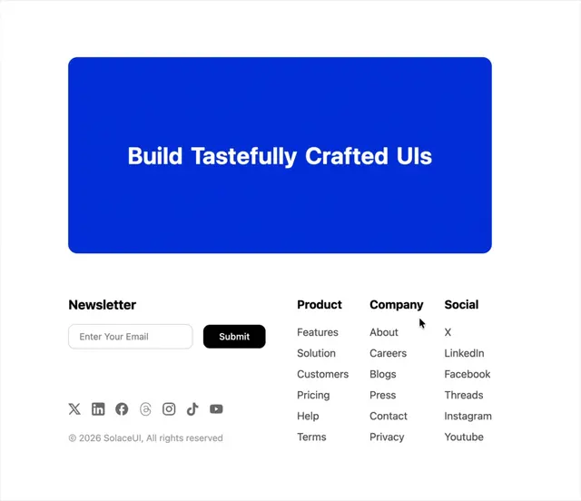

# Footer with a big royal-blue banner 'Build Tastefully Crafted UIs' over a newsletter field, link columns and social icons

**Discipline:** web ·  · **Design style:** Warm & Organic
**Tags:** component, footer, cta, blue, newsletter, link-columns, social-icons, white

## What it is
A white page with a large royal-blue rounded rectangle holding a bold white centred headline, and below it a Newsletter block with an email input and black Submit, a row of grey social icons and a copyright, and three link columns (Product, Company, Social).

## What it means
Bold and tidy; one colour block leads into a plain footer.

## Techniques
- Lead the footer with a large colour CTA block.
- Follow with a newsletter and link columns.
- Keep icons grey.
- Use black for the submit button.

## Best for
- Footer with CTA components
- SaaS templates
- Blue brand footers

## Vocabulary
- **CTA banner** — A colour block with a single headline.
- **Newsletter form** — An email field with a submit button.
- **Link column** — A heading and list of footer links.
- **Social icon row** — A row of small platform icons.
