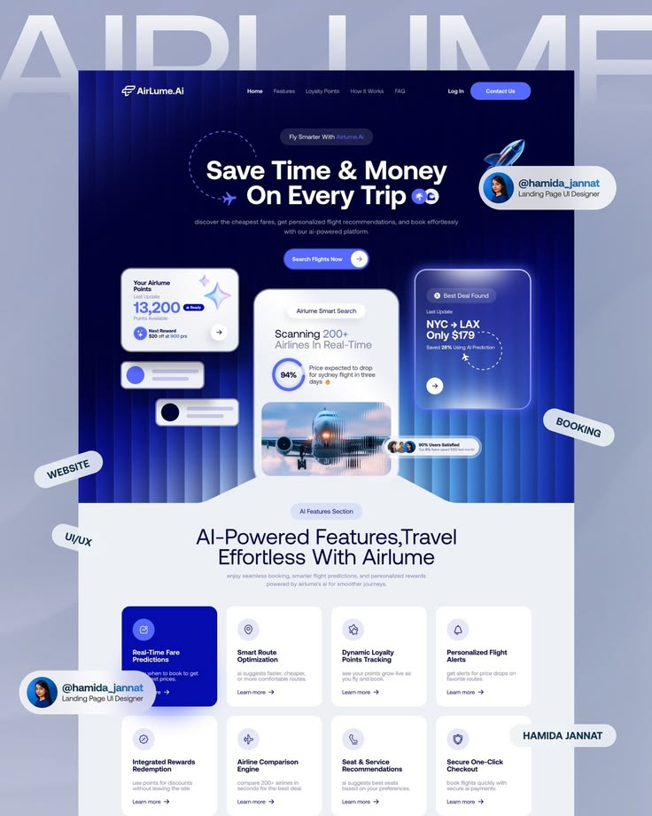

# Blue Striped AI Flights Landing Page

**Discipline:** web · **Design type:** SaaS landing page
**Tags:** ai, flights, blue, stripes, glass-cards, navy, ghost-type, creator-chips

## What it is
A landing page in a presentation on periwinkle with giant ghost lettering, a hero of deep blue vertical stripes with a headline 'Save Time & Money On Every Trip', glassy points and deal cards around a search phone, and a grid of feature cards below, with floating tag pills and creator chips.

## What it means
Vertical light stripes give a futuristic stage-light feel, and glass cards make data feel light.

## Techniques
- Vertical striped gradient hero background
- Frosted glass cards floating at different depths
- Highlighted first feature card in cobalt
- Circular dashed flight path around the headline
- Floating tags and creator chips around the frame

## Best for
- AI travel and booking sites
- Dark-to-light landing pages
- Showcasing landing pages on Dribbble-like boards

## Vocabulary
- **Stripe glow** — Vertical bands of light forming a backdrop.
- **Feature card grid** — A grid of cards each describing one feature.
- **Creator chip** — A pill showing a designer's avatar and handle.
