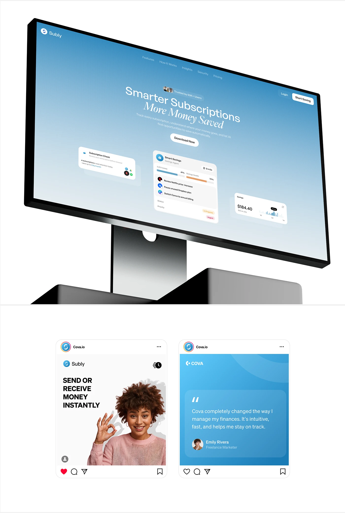

# Blue Subscription Landing on Tilted Monitor with Social Posts

**Discipline:** web ·  · **Design style:** Editorial
**Tags:** monitor, tilted, blue-gradient, serif-italic, social-posts, white, subscriptions

## What it is
A white board with a large tilted monitor on black pedestals showing a sky-blue gradient landing page with a serif headline, floating white UI cards and a Download Now pill, above two Instagram post mockups: a white one 'Send or receive money instantly' with a woman making an OK sign and a blue quote card.

## What it means
A steep tilt and blue gradient make the site feel airy and dynamic, and the posts prove the system on social.

## Techniques
- Steeply tilted monitor on angular black bases
- Italic serif line in a sans headline
- Floating white cards on a gradient hero
- Instagram post frames as a second row
- Blue gradient used in both web and social

## Best for
- Web plus social presentation boards
- Fintech subscription products
- Tilted device showcases

## Vocabulary
- **Tilted monitor** — A desktop screen rotated in perspective.
- **Post mockup** — A social post shown inside platform chrome.
- **Floating card** — A UI card set over a gradient at an angle.
