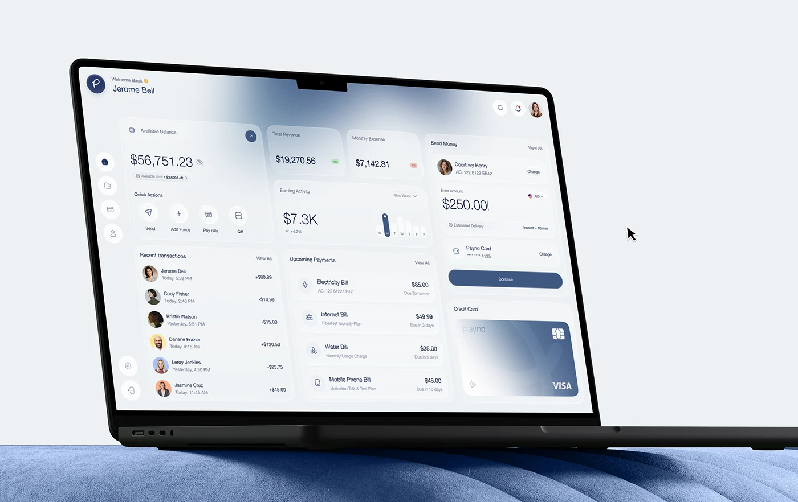

# Frosted Banking Dashboard on Blue Velvet

**Discipline:** web · **Design type:** Device mockup scene
**Tags:** laptop, dashboard, frosted, blue-grey, velvet, cursor, banking

## What it is
A laptop tilted on a ribbed blue velvet cushion against a pale blue wall, showing a frosted banking dashboard with balance, quick actions, transactions, upcoming bills, an earning chart, send money form and a credit card, with a mouse cursor nearby.

## What it means
The blue velvet matches the UI's blue and adds tactile richness, and frosted cards keep the data calm.

## Techniques
- Ribbed velvet as a stage matched to the palette
- Frosted white cards over a blue-grey wash
- Laptop cropped by the frame edge
- Cursor arrow implying interactivity
- Pale blue wall backdrop

## Best for
- Banking dashboard presentations
- Tonal mockup scenes
- Frosted glass desktop UI

## Vocabulary
- **Tonal stage** — A set whose colour matches the interface.
- **Frosted card** — A translucent blurred card.
- **Cursor prop** — A pointer graphic added to imply interaction.
