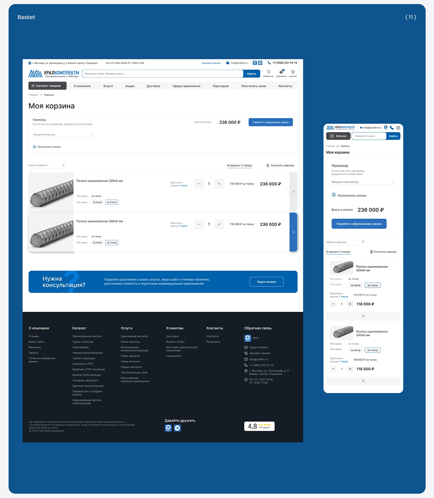

# Cart page on a deep blue board, desktop and mobile, with promo box and dark footer

**Discipline:** web ·  · **Design style:** Dark & Neon
**Tags:** cart, checkout, blue, white-ui, footer, mobile, industrial, cyrillic

## What it is
A deep blue rounded board numbered (11) showing a white basket page with search, nav, promo box, total and blue checkout button, product rows with quantity steppers, a blue consultation banner and dark navy footer, plus a mobile version.

## What it means
Reliable and clear; large blue frame ties the UI to the brand.

## Techniques
- Frame screens on a solid brand-blue board.
- Group promo, total and CTA in one card.
- Use a dark footer with multiple columns.
- Show desktop and mobile side by side.

## Best for
- B2B cart designs
- Design case-study boards
- Utilitarian commerce

## Vocabulary
- **Quantity stepper** — Plus and minus controls around a number.
- **Promo box** — A field for entering a promo code.
- **Consultation banner** — A blue block inviting a question.
- **Board frame** — A coloured slide holding screens.
